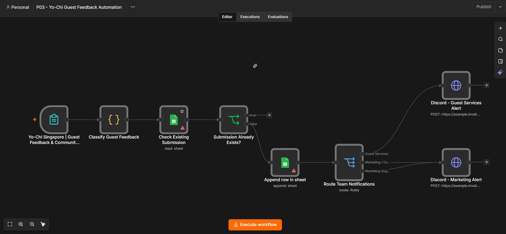

# P03 — Yo-Chi Guest Feedback Automation

An independent portfolio demonstration using n8n, JavaScript, Google Sheets, and Discord. This is **not an official Yo-Chi Singapore project** and is not affiliated with or endorsed by Yo-Chi. Use fictional information only; no real guest enquiries are processed by this portfolio copy.

## Business problem

Guest feedback, complaints, suggestions, and partnership enquiries require different follow-up. This demonstration shows how a structured form can classify submissions, record them in a tracker, skip an already known submission ID, and notify the relevant team.

## Workflow Overview



The workflow collects guest feedback, classifies submissions using rule-based JavaScript, checks for duplicates, records new submissions in Google Sheets, and routes team notifications to Discord.

## Automation flow

1. **Form:** collects guest name, email, visit date, rating, feedback, and enquiry type, with an independent-demo disclaimer.
2. **JavaScript classification:** assigns category, priority, issue type, team, status, and a timestamp/index-based submission ID. Food-safety keyword matches become high-priority complaints. Explicit complaints or ratings 1–2 become medium-priority complaints, with queue/cleanliness subtypes. Community/event enquiries, suggestions, compliments, and neutral feedback follow the remaining rules in precedence order.
3. **Duplicate lookup:** searches `Feedback_Log` for `Submission ID`. The lookup emits an item even with no matching row. The IF node stops the existing-ID branch and sends the other branch to append.
4. **Google Sheets:** appends 15 explicitly mapped fields, including classification and review status.
5. **Switch:** routes complaints to guest services and community engagement/suggestions to marketing. Compliments and general feedback remain logged without a notification route.
6. **Discord:** posts portfolio-labelled category, priority, issue/opportunity, rating, team, and review instructions. Templates omit guest names, emails, and raw feedback.

## Technologies

- n8n built-in node versions recorded in the export: Form Trigger 2.6, Code 2, Google Sheets 4.7, IF 2.3, Switch 3.4, and HTTP Request 4.5.
- Rule-based JavaScript classification using keyword/rating rules and n8n expressions; not an AI classification model.
- Google Sheets OAuth2, row lookup, and append operations.
- Discord incoming webhooks through HTTP POST.

## Files

- `P03 - Yo-Chi Guest Feedback Automation.sanitized.json`: inactive, unconfigured workflow prepared for import.
- `SANITIZATION_REPORT.md`: complete changes, validation evidence, and remaining risks.
- `README.md`: overview and setup guidance.

Publish only this folder after review. The parent folder contains the original unsanitized export.

## Live Development Workflow Testing

During development, successful manual node tests and a complete single-run suggestion test were performed on the **original working n8n workflow**, as reported by the developer. These are development runtime results, separate from the Codex review of the sanitized export. No additional scenario results, performance metrics, or screenshots are claimed here.

## Offline structural validation of the sanitized export

On 20 October 2026, offline checks passed for strict JSON parsing, eight nodes and eight connection edges, valid node references, unchanged JavaScript source, duplicate-detection conditions, Switch routing, all 15 Sheets mappings, and both Discord templates. Source service references and private identifiers were removed; pinned data is empty and the workflow is inactive. The original file's SHA-256 was unchanged.

During the Codex review, no workflow code was executed and no external services were contacted. The **sanitized JSON was not imported into n8n or runtime-tested**; its import structure was checked statically. Importer acceptance, version compatibility, classifier scenarios, duplicate behavior, Sheets writes, and Discord delivery remain unverified for this sanitized copy. This review boundary does not imply n8n was unavailable in the developer's environment or negate the development tests above. No response-time savings or production-performance claims are made.

## Setup requirements

1. Use a separate n8n test instance supporting the exported node versions. Import the JSON as a **new** workflow and keep it inactive. Actual importer acceptance and version compatibility still require confirmation in your instance.
2. Create your own spreadsheet with a tab named `Feedback_Log` and these exact column headers, in this order:

```text
Submission ID | Submitted At | Guest Name | Guest Email | Visit Date | Guest Rating | Rating Score | Feedback Message | Enquiry Type | Category | Priority | Issue Type | Assigned Team | Status | Form Mode
```

3. In **both** Google Sheets nodes, replace `REPLACE_WITH_YOUR_SPREADSHEET_ID` with your document ID and select your own Google Sheets OAuth2 credential. Confirm the tab and mappings after selection. No original credential reference is included.
4. Replace the two `example.invalid` URLs in the Discord HTTP Request nodes with your own private test webhook URLs. Suggestions and community engagement share the marketing endpoint. Keep the webhook URLs secret; never publish a configured export.
5. Review the imported form URL, disclaimer, parameters, credentials, and destination permissions. Its webhook identifier was regenerated. Use fictional input such as `Demo Guest` and `guest@example.com`.
6. After separate approval to execute, test food-safety keywords, low-rating queue/cleanliness complaints, community/event enquiries, suggestions, positive/neutral feedback, and an identical existing Submission ID. Confirm rows and intended routes, including no positive/neutral notification. These are proposed checks for the newly configured sanitized copy, not completed test results for that copy.
7. Review error handling and privacy controls before broader use. Activation or live-workflow changes require owner approval.

## Limitations

- Substring rules can miss concerns or flag negated phrases. Food-safety terms override other categories, and low ratings can override a partnership selection. This is not a reliable operational food-safety escalation system.
- Duplicate detection checks an ID derived from the numeric characters of `submittedAt` plus the item index, not feedback content. Missing/repeated timestamps can collide; new timestamps can bypass the check. Lookup and append are not atomic under concurrent submissions.
- A notification failure after a successful append may not be resent on retry because the row already exists. There is no dedicated recovery branch.
- Append expressions use the first classified item and assume one submission per execution.
- General feedback and compliments have no notification fallback. High-priority complaints use the same guest-services route as other complaints.
- Permissions, delivery failures, rate limits, abuse controls, retention, and service compatibility need further testing. Real input can contain personal data or spreadsheet formulas; fictional-data instructions are not access controls.

## Publication and review

The copy contains no usable credentials, spreadsheet ID, or Discord endpoint. Review it before publication and sanitize any later configured export again. No files have been pushed to GitHub and no live workflow has been changed.
